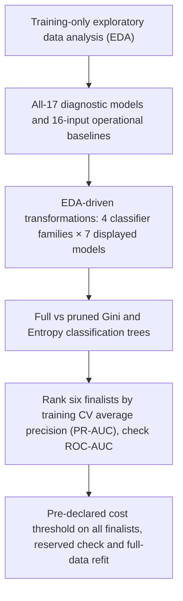

# DSA211 — Online Shoppers Purchase Prediction

**Research question:** How well do characteristics of an online browsing session predict whether the session ends in a purchase (`Revenue=1`)?

## Analysis workflow



## Files

- [Group analysis notebook](online_shoppers_analysis.ipynb) — executable EDA, classifier and tree comparisons, figures and conclusions.
- [Online Shoppers UCI dataset](data/online_shoppers.csv) — the original 12,330-session input, unmodified.
- [Python dependencies](requirements.txt) — pinned Python 3.12 environment.
- [27 October group meeting](27%20Oct%20Meeting.md) — meeting decisions and open questions.

## Run the analysis

From the repository root:

```bash
python -m pip install -r requirements.txt
jupyter lab
```

Open `online_shoppers_analysis.ipynb` and run all cells in order. The notebook reads `data/online_shoppers.csv`. It needs **no personal-repository files, version folders, PRDs, development logs or previously generated artefacts**. Tables and plots are rendered directly in the notebook.

## Statistical approach

The initial diagnostic comparison uses all **17 original predictors**, followed by operational models built with **16 inputs**. `PageValues` is excluded from the operational models as a precaution because its availability at the intended intervention time is unverified; this does not, by itself, establish data leakage.

Four classifier families are compared: Logistic Regression, linear discriminant analysis (LDA), Gaussian Naive Bayes and Bernoulli Naive Bayes. Each has seven consecutively labelled models in the main tables: **L1–L7, D1–D7, G1–G7, B1–B7** (**28 displayed**). Internally, the same sequential candidate evaluations are retained to reproduce the selection decisions (43 planned, 38 scored, five inapplicable). Both Gini and Entropy classification trees are evaluated before and after cost-complexity pruning.

Models use a shared **seed-42 stratified 80/20 split** (9,864 training / 2,466 previously inspected reserved observations) and **five training folds**. All preprocessing, feature transformations and inner tuning fit only on their relevant training folds. Within each classifier family, the exploratory sequential **one-SE complexity rule** compares each challenger with the current incumbent using mean five-fold CV **average precision (AP, PR-AUC)**. AP is also used for inner tuning, grouped backward LDA selection and tree cost-complexity pruning. Across the **six finalists**, the highest mean training CV AP determines the winner; ROC-AUC is reported as corroboration. Display IDs are presentation aliases; the original trial IDs and full historical selection path remain unchanged.

## Main results

The six-way winner is **L6 Logistic Regression** (original trial **L13**), with mean five-fold training **AP 0.34207** and **ROC-AUC 0.75096**. The second-ranked finalist by AP is the pruned Entropy tree (**AP 0.32105**, ROC-AUC 0.74397). Bernoulli Naive Bayes **B7** has AP 0.31406 and ROC-AUC 0.74402.

The previously consulted reserved sample produces **AP 0.32534** and **ROC-AUC 0.73804**. These results are descriptive: the reserved set was examined during project development, so it is **not an untouched independent holdout**. The final selected recipe is also refitted on the full dataset.

The notebook pre-declares a hypothetical **0.20 contact threshold** from S$3 contact cost, S$50 gross margin and 30% conditional upsell-success assumptions, compares four references for the winner, and applies the same declared threshold to all six finalists. The pruned Entropy tree has the lowest hypothetical training-fold classification loss at that threshold; Logistic Regression still wins on the pre-declared AP criterion. These assumptions are illustrative, not measured intervention effects. Neither ranking performance nor hypothetical cost illustrations establish calibrated probabilities, causal uplift or deployable profitability.

**For group review:** Explain the AP-first selection criterion, justify `PageValues` timing, and decide whether the hypothetical decision-cost framing belongs in the final proposal. This is a **prediction** project rather than a causal-inference analysis.

## Reproducibility

The GitHub Actions [notebook execution workflow](.github/workflows/execute-notebook.yml) executes the notebook from scratch using the shared CSV, checks cell completion, validates model summary values and verifies the expected classifier labels and candidate-accounting results. On analysis branches it commits the executed `.ipynb` to the branch after the checks pass. Generated local files and caches are ignored; saved notebook cell outputs are the group-facing record.
